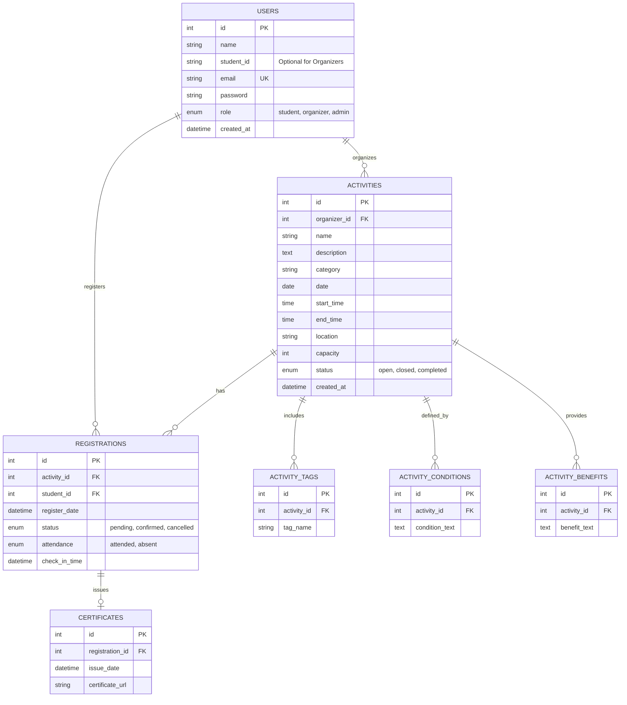

# Database Design & ER Diagram: Project RM

สรุปการออกแบบฐานข้อมูลสำหรับระบบจัดการกิจกรรม (Event Management System) โดยอ้างอิงจากโค้ดชุดปัจจุบัน

## 1. ER Diagram (Mermaid)

## 2. รายละเอียดตาราง (Table Details)

### 2.1 ตาราง `users`
เก็บข้อมูลผู้ใช้งานระบบ ทั้งนักศึกษา ผู้จัดโครงการ และผู้ดูแลระบบ
- `id`: รหัสหลักของ User (Primary Key)
- `student_id`: รหัสนักศึกษา (สำหรับ Role 'student')
- `role`: บทบาท (student = นักศึกษา, organizer = ผู้จัดกิจกรรม, admin = ผู้ดูแลระบบ)

### 2.2 ตาราง `activities`
เก็บข้อมูลกิจกรรมที่ถูกสร้างขึ้นโดยผู้จัด (Organizer)
- `organizer_id`: FK ชี้ไปยัง `users.id` เพื่อระบุว่าใครเป็นคนสร้าง
- `capacity`: จำนวนที่นั่งสูงสุด
- `status`: สถานะกิจกรรม (กำลังเปิดรับ, ปิดรับ, เสร็จสิ้นกิจกรรม)

### 2.3 ตารางประกอบกิจกรรม (`activity_tags`, `_conditions`, `_benefits`)
แยกออกมาเพื่อรองรับข้อมูลที่เป็นรายการ (List) หลายรายการต่อ 1 กิจกรรม
- ทำให้สามารถเพิ่มเงื่อนไขหรือสิทธิประโยชน์ได้ไม่จำกัด

### 2.4 ตาราง `registrations`
ตัวกลางระหว่างนักศึกษากับกิจกรรม (Many-to-Many relationship)
- `status`: สถานะการลงทะเบียน (เช่น ยืนยันแล้ว หรือ ยกเลิก)
- `attendance`: สถานะการเข้างาน (ใช้สำหรับเช็คอิน)
- `check_in_time`: เวลาที่นักศึกษามาเช็คอินจริง (จากการสแกน QR Code)

### 2.5 ตาราง `certificates`
เก็บข้อมูลเกียรติบัตรที่ออกให้นักศึกษาหลังจากเข้าร่วมกิจกรรมสำเร็จ
- ผูกกับ `registration_id` เพราะ 1 การเข้าชม = 1 เกียรติบัตร

---
*หมายเหตุ: การออกแบบนี้ยืดหยุ่นพอที่จะนำไปสร้าง SQL Database (MySQL, PostgreSQL) หรือนำไปใช้กับ Prisma ORM ใน Next.js ได้ทันที*
